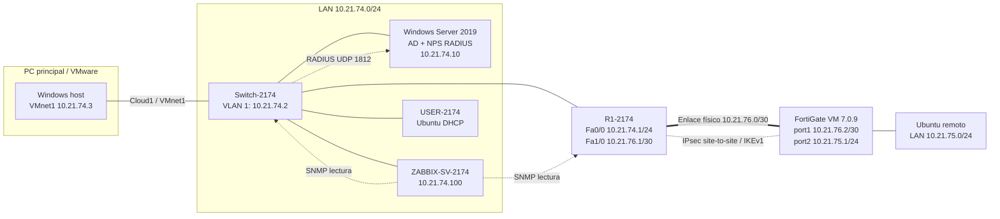
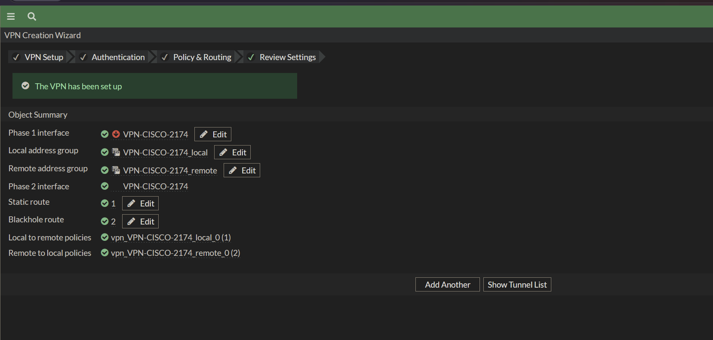
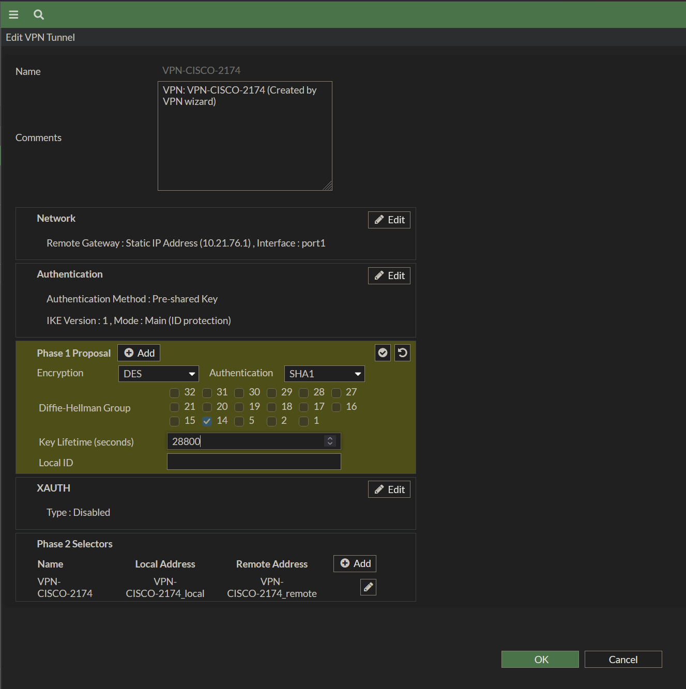
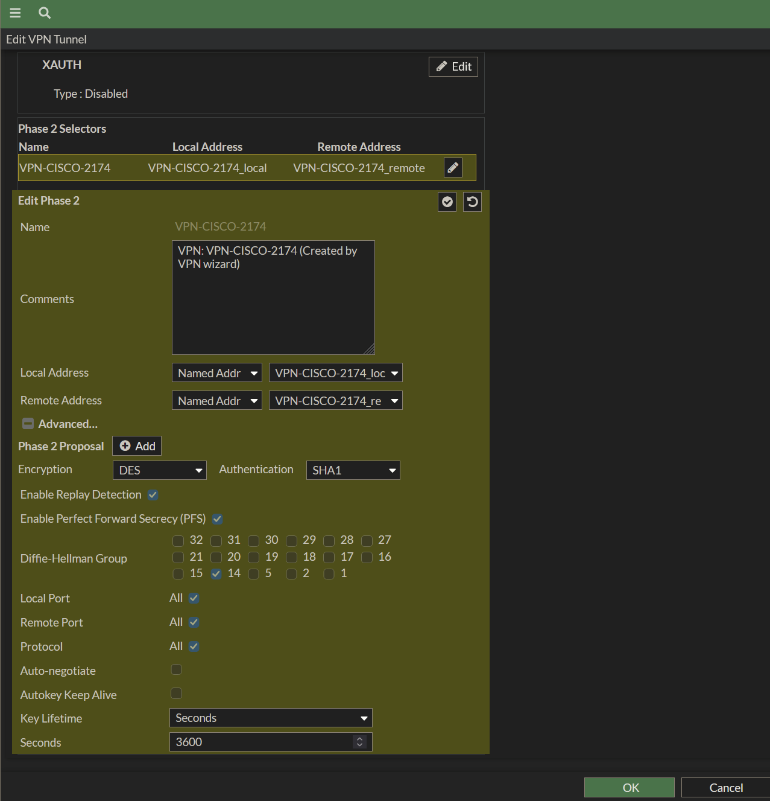
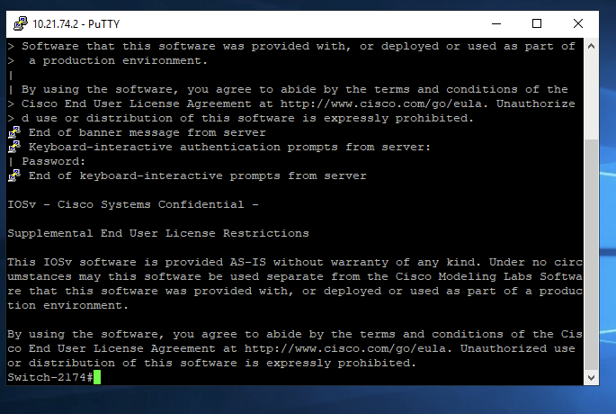
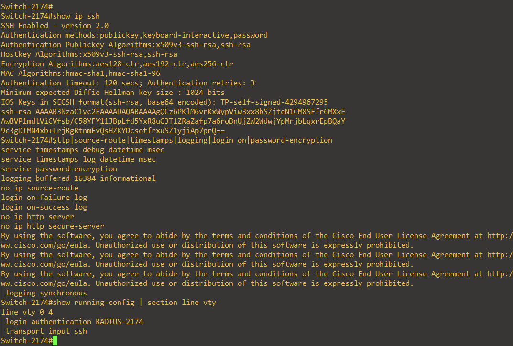
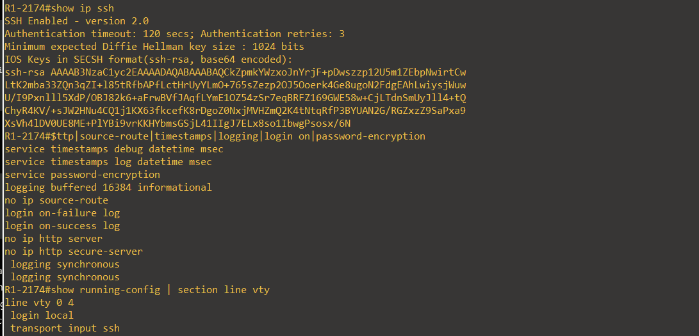
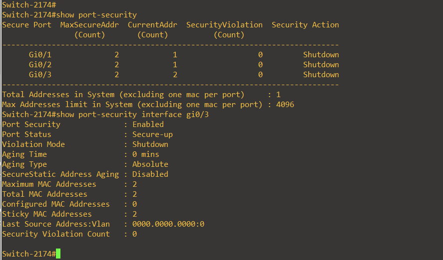
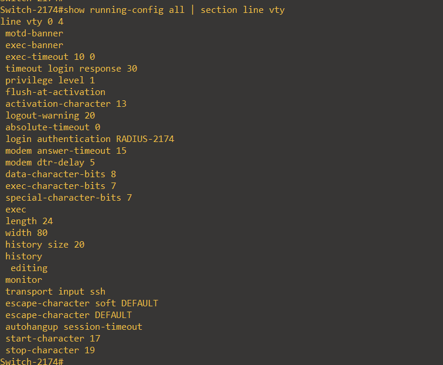
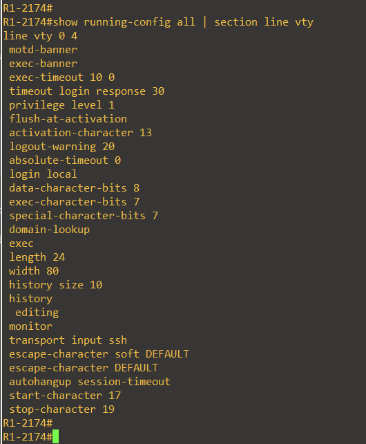

# Segundo Parcial — Seguridad de Redes | 2025-2174

> **Laboratorio de seguridad en GNS3:** VPN IPsec site-to-site Cisco–FortiGate, DHCP, SSH, AAA/RADIUS (NPS), monitoreo Zabbix/SNMP y endurecimiento de dispositivos Cisco.

**🎥 Video de demostración (máximo 10 minutos):** `ENLACE_DE_YOUTUBE_PENDIENTE`  
**Estudiante:** Luis Ariel Alevante Agramonte · **Matrícula:** `2025-2174` · **Fecha de pruebas:** 11 de noviembre de 2026

---

## 1. Objetivo

Construir y verificar una infraestructura de red segmentada en un laboratorio GNS3, que integre administración segura por SSH, servicio DHCP, autenticación centralizada mediante Windows NPS, visibilidad SNMP desde Zabbix y comunicación cifrada por VPN IPsec entre el Router Cisco y FortiGate. Se documentan controles de hardening aplicados y resultados observados.

## 2. Topología implementada



La topología se ejecutó en **GNS3 VM / VMware**. El PC anfitrión accede a la LAN virtual mediante **VMnet1**. El **túnel IPsec protege el tráfico entre `10.21.74.0/24` y `10.21.75.0/24`**, no el propio enlace WAN `/30`.

## 3. Direccionamiento

| Equipo | Interfaz | IP / segmento | Función |
|---|---|---|---|
| `R1-2174` | Fa0/0 | `10.21.74.1/24` | Gateway LAN + DHCP + SSH |
| `Switch-2174` | VLAN 1 | `10.21.74.2/24` | Administración SSH + SNMP |
| PC anfitrión | VMware VMnet1 | `10.21.74.3/24` | Administración local |
| Windows Server | Ethernet | `10.21.74.10/24` | Dominio `infra2.local`, NPS/RADIUS |
| ZABBIX-SV-2174 | Ethernet | `10.21.74.100/24` observado | Monitoreo SNMP |
| USER-2174 | Ethernet | DHCP `10.21.74.0/24` | Pruebas de usuarios |
| `R1-2174` | Fa1/0 | `10.21.76.1/30` | Extremo VPN Cisco |
| FortiGate | port1, DHCP | `10.21.76.2/30` | Extremo VPN FortiGate |
| FortiGate | port2 | `10.21.75.1/24` | Puerta de enlace remota |
| Ubuntu remoto | Ethernet | `10.21.75.0/24` | Segmento de destino; IP fija prevista `10.21.75.10` |

## 4. Implementación

### 4.1 DHCP en el Router

El servicio `LAN-2174` entrega direcciones de la red `10.21.74.0/24`, con exclusiones de `.1–.99` y `.201–.254`. En la verificación se observó la concesión `10.21.74.100` del servidor Zabbix. El pool adicional `FORTIGATE-WAN` asigna `10.21.76.2` al FortiGate en el enlace `/30`.

```cisco
ip dhcp pool LAN-2174
 network 10.21.74.0 255.255.255.0
 default-router 10.21.74.1
 dns-server 10.21.74.10
!
ip dhcp pool FORTIGATE-WAN
 network 10.21.76.0 255.255.255.252
 default-router 10.21.76.1
```

### 4.2 SSH y AAA/RADIUS

El Router usa **SSH v2 con autenticación local**; el Switch usa **SSH v2 con RADIUS en Windows NPS**, manteniendo autenticación local de respaldo. En las líneas VTY de ambos equipos se comprobó `transport input ssh` y `exec-timeout 10 0`.

Para el Switch se verificaron eventos del servidor NPS: **6272 (aceptado)** y **6273 (rechazado)**. La política `CISCO-2174-RADIUS` usa el grupo de Active Directory `Cisco-Admins-2174`. No se atribuye RADIUS al Router, pues su configuración muestra acceso local.

### 4.3 Zabbix + SNMP

En Zabbix se incorporaron Router y Switch para monitoreo mediante **SNMPv2c de solo lectura**. La comunidad SNMP se omite de los archivos públicos. La disponibilidad de los dispositivos se verificó desde la interfaz Zabbix; su configuración de servidor y el direccionamiento son descritos en [docs/implementacion.md](docs/implementacion.md).

### 4.4 Port-security en el Switch

Los puertos `Gi0/1–Gi0/3` utilizan máximo **2 direcciones MAC**, aprendizaje **sticky** y acción **shutdown** por infracción. La práctica incluyó una prueba de violación y recuperación a `Secure-up` en `Gi0/3`.

### 4.5 VPN IPsec Cisco–FortiGate

La VPN `VPN-CISCO-2174` conecta los segmentos `10.21.74.0/24` y `10.21.75.0/24`, con propuestas coincidentes:

| Ajuste | Valor negociado |
|---|---|
| IKE | v1, Main Mode, PSK |
| Fase 1 | DES / SHA1, DH14, 28800 s |
| Fase 2 | ESP-DES / HMAC-SHA1, PFS DH14, 3600 s |
| Peer Cisco | `10.21.76.1` |
| Peer FortiGate | `10.21.76.2` |
| Red local Cisco | `10.21.74.0/24` |
| Red local FortiGate | `10.21.75.0/24` |

El asistente de FortiGate creó **dos políticas en ambos sentidos**, además de la ruta IPsec y una ruta blackhole de respaldo. Para conservar acceso desde el PC principal se añadió una ruta `/32` en FortiGate: `10.21.74.3/32` vía `10.21.76.1`, por `port1`. Cisco posee la ruta `10.21.75.0/24` hacia `10.21.76.2`.

> **Limitación del laboratorio:** DES y SHA1, al igual que IKEv1, son algoritmos/protocolos heredados. Se utilizaron por las opciones de esta imagen de laboratorio y **no son adecuados para una VPN de producción**. Para entornos reales, utilizar IKEv2 y suites modernas (por ejemplo AES-GCM), sujeto a compatibilidad.

## 5. Validación y resultados

| Prueba | Evidencia observada | Resultado |
|---|---|---|
| Router → FortiGate | Ping `10.21.76.2` | 5/5 exitosos |
| IKE / Fase 1 | `show crypto isakmp sa`: `QM_IDLE`, `ACTIVE` | Correcto |
| IPsec / Fase 2 | ESP inbound/outbound `ACTIVE(ACTIVE)` | Correcto |
| Tráfico por VPN | `ping 10.21.75.1 source 10.21.74.1 repeat 5` | **5/5 exitosos** |
| Cifrado IPsec | `#pkts encaps: 5`, `#pkts decaps: 5` | **5 enviados / 5 recibidos** |
| Errores IPsec | `#send errors 0`, `#recv errors 0` | Sin errores |
| DHCP LAN | `show ip dhcp binding` | `10.21.74.100` activa |
| Switch AAA/NPS | Event Viewer ID 6272 y 6273 | Éxito y denegación observados |
| SSH | `show ip ssh` | v2 en Router y Switch |
| Port-security | `show port-security interface gi0/3` | Secure-up, max 2 |

**Capturas de evidencia:**

**VPN — creación del túnel y parámetros**







**SSH y hardening**













La prueba final **5/5** y contadores ESP constan en el resultado de consola de la práctica. Si se necesita prueba gráfica idéntica, añadir una captura directa de Cisco del mismo comando en `evidencias/vpn/` antes de entregar.

## 6. Hardening alineado con CIS

Se documentaron controles de SSH-only, eliminación de servicios HTTP administrativos, `no ip source-route`, registros syslog, marcas de tiempo, registros de inicio de sesión y timeout de 10 minutos. En el Switch también Port-Security. La tabla de control, evidencia y limitaciones aparece en [docs/hardening-cis.md](docs/hardening-cis.md).

**Nota:** las verificaciones prueban medidas puntuales y no certifican la totalidad de CIS Benchmark. La corrección de línea auxiliar del Router fue recomendada, pero no consta evidencia posterior que confirme su aplicación.

## 7. Archivos y documentación

- [`running-configs/`](running-configs/): extractos de Router y Switch y configuración FortiGate derivada del backup, **sin secretos**.
- [`docs/implementacion.md`](docs/implementacion.md): funciones, IP, VPN y NPS.
- [`docs/hardening-cis.md`](docs/hardening-cis.md): controles y evidencias.
- [`docs/validacion.md`](docs/validacion.md): pruebas comprobadas, comandos y resultados.
- [`evidencias/`](evidencias/): imágenes del entorno que respaldan la documentación.
- [`scripts/`](scripts/): comandos de verificación y guion para la demostración.

## 8. Conclusión

El laboratorio demuestra administración por SSH, monitoreo SNMP, autenticación RADIUS del Switch, seguridad de puertos y **VPN site-to-site con intercambio bidireccional de tráfico cifrado** entre Cisco y FortiGate. La prueba final obtuvo **100 % de conectividad (5/5)** y contadores IPsec de cifrado y descifrado positivos. Se identificaron además los límites de seguridad de la criptografía heredada y las opciones de endurecimiento aún mejorables.

---

**Laboratorio académico.** Los extractos públicos excluyen contraseñas, hashes, secretos VPN, credenciales RADIUS y comunidad SNMP. No restaurar configuraciones sanitizadas directamente sobre equipos productivos.
