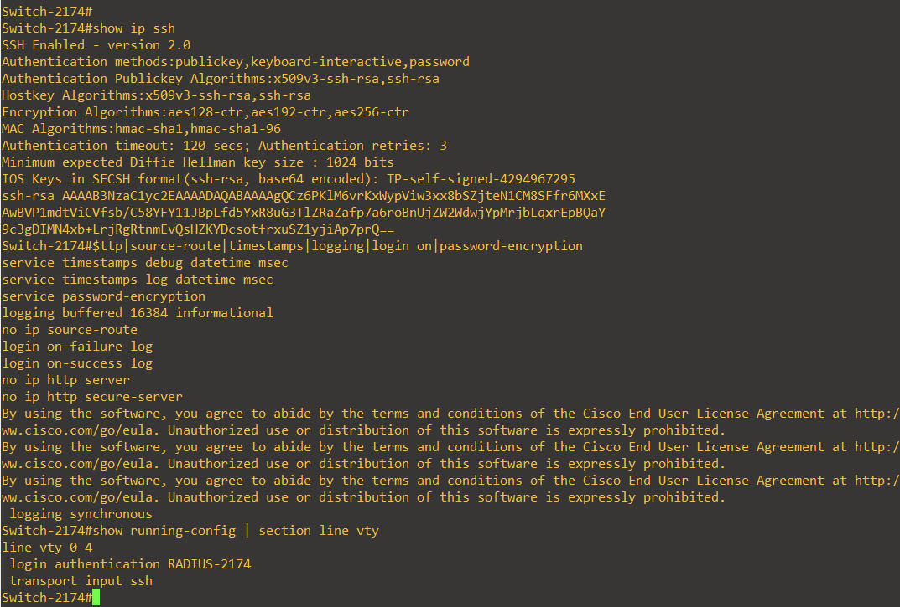
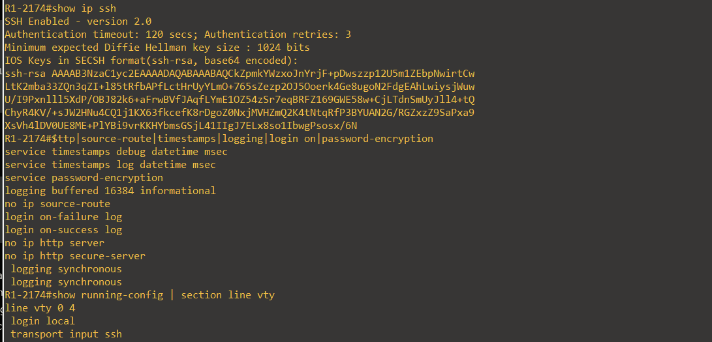
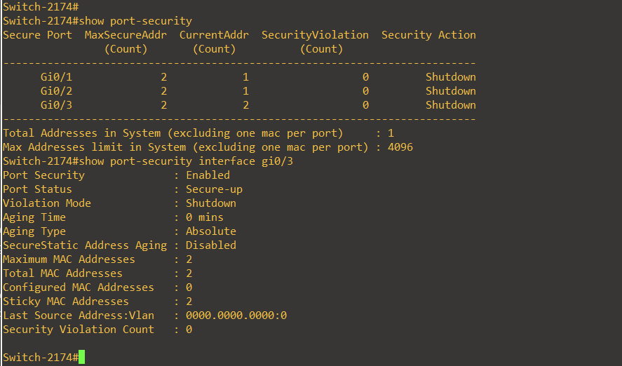
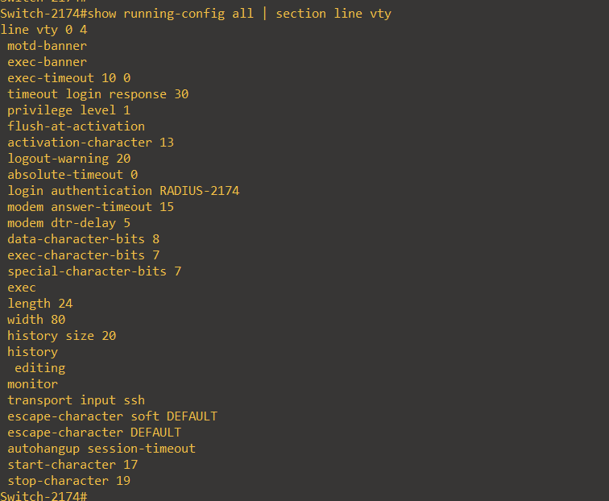
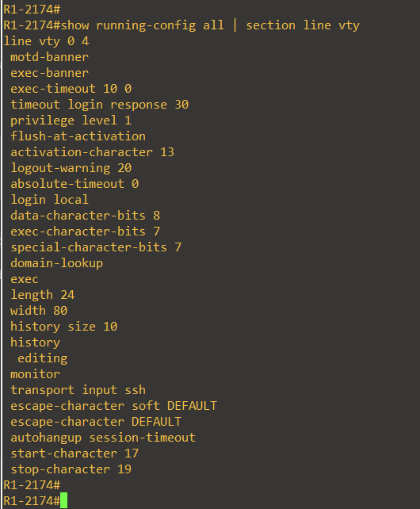

# Hardening — medidas alineadas con CIS Cisco IOS Benchmark

Este laboratorio **no declara conformidad integral** con una edición/perfil particular del CIS Benchmark. Se describen medidas efectivamente aplicadas y verificadas en Cisco IOS 15.2, sin asignar números de control no cotejados con la edición específica.

| Medida | Router | Switch | Evidencia / razón |
|---|---|---|---|
| SSH v2 | Sí | Sí | `show ip ssh` — deshabilitar versiones antiguas |
| VTY solo SSH | Sí | Sí | `transport input ssh` — sin Telnet |
| Timeout VTY 10 minutos | Sí | Sí | `show running-config all \| section line vty` |
| HTTP y HTTPS IOS desactivados | Sí | Sí | `no ip http server`, `no ip http secure-server` |
| IP source routing desactivado | Sí | Sí | `no ip source-route` |
| Auditoría login aceptado/rechazado | Sí | Sí | `login on-success log`, `login on-failure log` |
| Logging buffered y timestamps | Sí | Sí | `logging buffered 16384 informational`, `service timestamps log datetime msec` |
| Secret para administración | Sí | Sí | `enable secret`, `username secret` en original (hashes omitidos del repo) |
| Administración vía RADIUS | No, local | Sí | `login authentication RADIUS-2174`, Windows NPS 6272/6273 |
| Port-security max 2 sticky/shutdown | N/A | Sí | `show port-security` y `show port-security interface gi0/3` |

## Riesgos y mejoras pendientes

1. **VPN heredada**: DES y SHA1 no satisfacen expectativas modernas de criptografía. Imagen de laboratorio limitada; para producción implementar IKEv2 con AES-GCM.
2. **SNMPv2c**: no cifra comunidad. Migrar a SNMPv3 y/o restringir explícitamente orígenes de consultas en producción.
3. **`service password-encryption`**: no garantiza protección criptográfica de secretos reversibles; se ocultaron de archivos públicos.
4. **Línea AUX del Router**: el `running-config` aportado mostraba `exec-timeout 0 0`, `privilege level 15`; se recomendó corregir a 10 minutos, privilegio 1 y login local. La ejecución posterior no se ha demostrado con evidencia.
5. **FortiGate port1**: el backup indica administración habilitada incluso por HTTP y SSH; se aconseja reducirla a HTTPS y PING si no hay necesidad de otros servicios, pero se preserva tal como figura en la evidencia original.
6. **NTP y logging externo**: no acreditados en este conjunto de evidencias; la consola y logs no sustituyen un servidor de syslog central ni fuente NTP confiable.

## Evidencia visual

